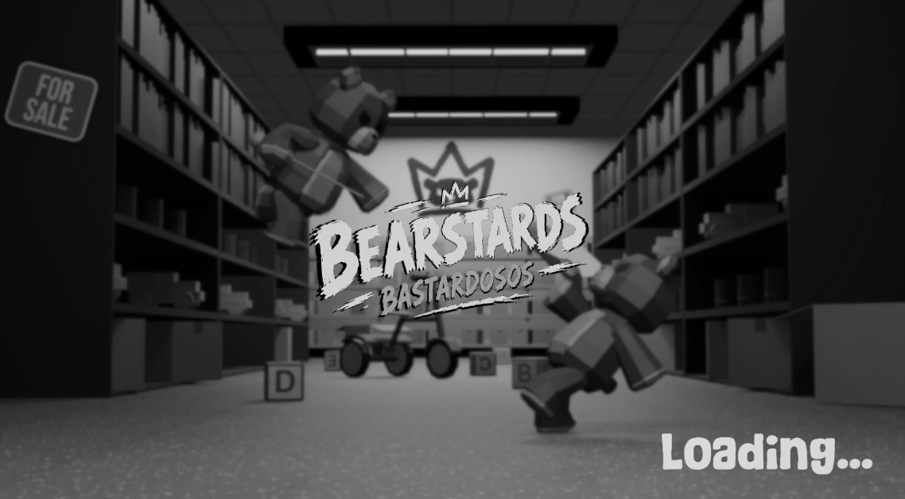
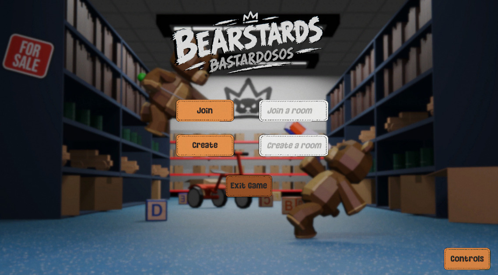
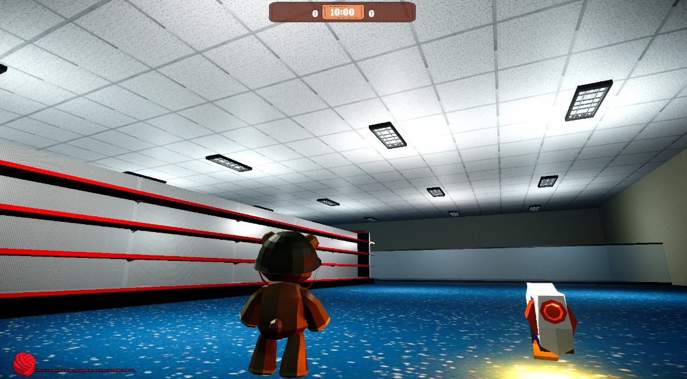
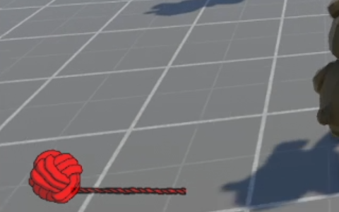
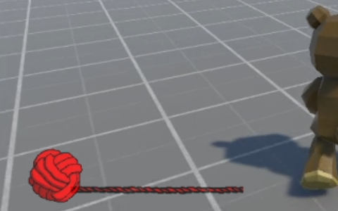

# Evidencia 2 — Portafolio de la interfaz y el estado de juego

**Materia:** Optativa: Creación de Videojuegos · Prof. Enrique Mascote · IDGS101N
**Equipo:** Turbo Studios · **Juego:** Little Bearstards (alt. Bastardosos)
**Fecha del documento:** domingo 25-oct-2026
**Integrantes:** Angel David Arras Orozco, Guillermo Martínez Delgadillo, Jesús Arturo Castilla González, Angel Guillermo González Gómez, Víctor Hugo Baeza Rocha y Dylan Muñoz Flores.

**PDF entregado:** [assets/Evidencia_2_Interfaz_Little_Bearstards.pdf](assets/Evidencia_2_Interfaz_Little_Bearstards.pdf). Este archivo resume su contenido; las capturas están en [assets/evidencia-2/](assets/evidencia-2/).

## Contenido del documento

1. Introducción · 2. Diseño de la interfaz · 3. Planificación · 4. Implementación · 5. Vínculo entre la interfaz y el estado del juego · 6. Pruebas · 7. Estado final y trabajo pendiente · 8. Registro de cambios · 9. Repositorio del proyecto · Referencias.

La interfaz cumple dos funciones: dejar al jugador entrar a una partida (pantalla de carga y menú principal) y comunicarle el estado de la partida mientras juega (tiempo restante, puntos de cada jugador y vida de su oso). Como el juego es de sigilo, la interfaz es **mínima**: ocupa poco espacio para no delatar al jugador ni distraerlo.

## Criterios de diseño

- **Coherencia estética:** estética de peluches, con texturas de tela cosida, bordes con puntada, colores cálidos (naranja y café) y elementos de costura como el estambre.
- **Legibilidad:** tipografía gruesa y de alto contraste sobre fondos oscuros o semitransparentes.
- **Mínima intrusión:** el HUD se concentra en la parte superior central y en la esquina inferior izquierda; el centro de la pantalla queda libre.

## Elementos de la interfaz y su estado (25-oct)

| Elemento | Pantalla | Función | Estado |
| --- | --- | --- | --- |
| Pantalla de carga | Carga | Indica que se está cargando la escena o la sala | Implementada |
| Botones Join y Create | Menú principal | Unirse a una sala o crear una sala | Implementados |
| Botón Exit Game | Menú principal | Salir del juego | Implementado |
| Botón Controls | Menú principal | Mostrar los controles del juego | Implementado |
| Temporizador | HUD de partida | Tiempo restante de la partida | Implementado |
| Contador de puntos | HUD de partida | Puntos de cada jugador | Implementado |
| Barra de vida (estambre) | HUD de partida | Vida actual del oso | Implementada y funcional |
| Contador de dardos | HUD de partida | Dardos disponibles de la pistola | Diseñado; pendiente de limitar la munición |
| Mensajes de fase | HUD de partida | Anuncian los cambios de fase y la aparición de la pistola | Diseñado |
| Pantalla de resultados | Resultados | Marcador final y victoria, derrota o empate | Render con osos animados hecho; pendiente de activarla al terminar el tiempo |

### Pantalla de carga

Reutiliza el render del menú principal con un filtro gris y el texto "Loading..." animado en la esquina inferior derecha. Mantiene la identidad visual sin producir otro recurso.

### Menú principal

Logotipo del juego sobre el render de un pasillo de la tienda con dos osos peleando, y pocos botones:

- **Join:** unirse a una sala existente (campo "Join a room").
- **Create:** crear una sala nueva (campo "Create a room").
- **Exit Game:** cerrar el juego.
- **Controls:** mostrar los controles, en la esquina inferior derecha.

Botones con fondo naranja y borde de puntada; campos de texto con fondo claro.

### HUD de partida: temporizador y puntos

Un solo panel en la parte superior central: el temporizador al centro (inicia en 10:00) y a cada lado el puntaje del jugador y el del oponente.

### Barra de vida: el estambre

En lugar de una barra tradicional, la vida se muestra con un **ovillo de estambre rojo** (ícono, al inicio de la barra) y una **hebra de estambre rojo** (la barra). Ambos recursos tienen fondo transparente. La hebra se acorta al recibir daño y se recupera o alarga al recoger un rollo de hilo (+25) o un casco (vida máxima de 100 a 125). Va en la esquina inferior izquierda.

### Elementos pendientes de implementar

- **Contador de dardos:** cuántos dardos quedan en la pistola (6 al inicio, sin recarga).
- **Mensajes de fase:** al cambiar de fase (Luces apagadas, Mercancía nueva, Remate final); en la fase 2 anuncia que apareció la pistola de dardos.
- **Pantalla de resultados:** al terminar el tiempo, marcador final en ambas pantallas con un render de los osos haciendo una animación de victoria o derrota, o un mensaje de empate. Desde ahí se regresa al menú principal.

## Boceto por zonas

| Zona de la pantalla | Elemento | Razón de la posición |
| --- | --- | --- |
| Superior central | Panel con temporizador y puntos de ambos jugadores | Es lo que más se consulta; no tapa la acción |
| Inferior izquierda | Ovillo y hebra de estambre (vida) | Lectura rápida, cerca del personaje |
| Inferior derecha | Contador de dardos (con pistola equipada) | Cerca del arma, que se ve a la derecha |
| Centro superior, debajo del panel | Mensajes de fase | Se notan sin tapar el centro; desaparecen tras unos segundos |
| Pantalla completa | Resultados | Solo al terminar la partida |

> El boceto dibujado (Figura 6) quedó pendiente de insertar en el PDF.

## Actualización en tiempo real

La interfaz **no calcula reglas**: solo muestra el estado que le entregan los componentes de juego. Cuando algo cambia, el componente que lo gestiona emite un evento y los elementos que lo escuchan se actualizan.

| Situación del juego | Evento | Elemento que se actualiza | Cambio en pantalla |
| --- | --- | --- | --- |
| Un oso recibe daño | Oso golpeado | Barra de vida | La hebra se acorta |
| El oso recoge un rollo de hilo | Objeto recogido | Barra de vida | La hebra se alarga (sin pasar del máximo) |
| El oso recoge un casco | Objeto recogido | Barra de vida | La vida máxima sube a 125 y la barra se ajusta |
| Un jugador elimina al rival o a un NPC | Oso eliminado | Contador de puntos | Se suma o resta el puntaje |
| El oso reaparece | Oso reaparecido | Barra de vida | Vuelve a vida completa (100) |
| Pasa el tiempo | Temporizador | Temporizador | El tiempo restante disminuye |
| Se dispara la pistola | Dardo disparado | Contador de dardos | Disminuye en 1 |
| Cambia la fase | Cambio de fase | Mensaje de fase | Aparece el mensaje del cambio |
| Se acaba el tiempo | Fin de partida | Pantalla de resultados | Se carga el marcador final |

## Menús, pausa y reinicio

- **Sin pausa en el MVP:** en un duelo en línea, pausar el tiempo dejaría al otro jugador esperando y afectaría el balance.
- **Reinicio:** al terminar la partida, la pantalla de resultados regresa al menú principal para crear o unirse a otra sala.
- **Desconexión:** si un jugador se desconecta, el otro recibe la victoria y el juego regresa al menú.

## Implementación

**Motor y herramientas:** Unity 6.6 (6000.6.3f1), interfaz con Canvas, texto con TextMeshPro y sincronización con Photon PUN2.

| Script | Elemento de la interfaz | Responsabilidad |
| --- | --- | --- |
| `HealthSystem` (`Health_System`) | Barra de vida (`healthBar`, `playerCanvas`) | Guarda la vida actual y máxima (100 por defecto) y actualiza la barra; el Canvas del oso solo se activa en el cliente dueño |
| `ScoreManager` (`Score_Manager`) | Puntos local y del oponente (`localScoreText`, `opponentScoreText`) | Inicializa y actualiza los puntajes de la sala y refresca los textos |
| `MatchTimer` | Temporizador (`timerText`) | Cuenta el tiempo de la partida y lo muestra |
| `HudPartida` | Textos de vida, dardos, puntaje, fase y tiempo | Muestra el estado al recibir los eventos |
| `RoomManager` | Pantalla de resultados | Coordina el fin de la partida y carga los resultados |
| `CreateAndJoinRooms` | Botones Join y Create y sus campos | Crea la sala o se une a ella con Photon PUN2 |

- **Referencias explícitas en el Inspector:** cada componente recibe sus elementos de interfaz con campos serializados (`[SerializeField]`), sin búsquedas en tiempo de ejecución. Si falta una referencia, se ve en el Inspector antes de ejecutar.
- **Sincronización:** el MasterClient lleva el temporizador y el marcador oficiales. `ScoreManager` guarda el puntaje con una clave por jugador (`Score_` + número de actor de Photon), así las dos PCs muestran lo mismo.
- **Vida personal:** `HealthSystem` solo muestra el Canvas de vida al dueño del oso y lo deshabilita en el cliente del oponente.

## Vínculo entre la interfaz y el estado del juego

| Elemento | Dato del estado | Componente que lo guarda | Cuándo se actualiza |
| --- | --- | --- | --- |
| Barra de vida (estambre) | Vida actual respecto a la máxima | `HealthSystem` / `ModeloDeVida` | Al recibir daño, al recoger hilo o casco y al reaparecer |
| Contador de puntos | Puntaje de cada jugador | `ScoreManager` con `ReglasDePuntos` | Al eliminar al rival (+200, +350 con sigilo o +400 con dardos) o a un NPC (−50) |
| Temporizador | Tiempo restante | `MatchTimer` / `ControladorDeFases` | Cada segundo; se sincroniza con el MasterClient |
| Contador de dardos | Dardos disponibles (6 al inicio) | `PistolaDeDardos` / `ToyGun` | En cada disparo |
| Mensaje de fase | Fase actual (1, 2 o 3) | `MatchTimer` / `ControladorDeFases` | Cada tercio del tiempo total |
| Botones Join y Create | Sala creada o unida | `CreateAndJoinRooms` | Al pulsar el botón |
| Pantalla de resultados | Victoria, derrota o empate | `RoomManager` / `ResultadoDePartida` | Al terminar el tiempo |

## Pruebas de la interfaz

| ID | Tipo | Caso de prueba | Resultado esperado | Resultado obtenido |
| --- | --- | --- | --- | --- |
| UI-01 | Normal | Recibir daño de la aguja o de un dardo | La hebra se acorta según el daño | *Pendiente de completar* |
| UI-02 | Normal | Recoger un rollo de hilo con la vida incompleta | La barra sube 25 sin pasar del máximo | ✅ La vida sube 25 (prueba P-02 del MVP) |
| UI-03 | Límite | Tocar un rollo de hilo con la vida completa | La barra no cambia y el objeto permanece | ✅ El oso no lo recoge hasta perder vida (prueba P-03 del MVP) |
| UI-04 | Normal | Eliminar al rival | El contador del atacante aumenta en ambas pantallas | *Pendiente de completar* |
| UI-05 | Error | Terminar el tiempo de la partida | Se muestra la pantalla de resultados | ❌ La partida continúa al llegar a 00:00; la solución está en otra rama y falta integrarla (prueba P-04 del MVP) |

## Estado final y trabajo pendiente (25-oct)

**Implementado:** pantalla de carga, menú principal, temporizador, contador de puntos y barra de vida con estambre (responde al daño y a la curación).

**Pendiente:**
- Mostrar el contador de dardos y limitar la munición.
- Mensajes de cambio de fase.
- Corregir el fin de partida: al llegar a 00:00 debe cargar el render de resultados (osos animados de victoria o derrota) o el mensaje de empate.

**Mejora futura propuesta:** pantalla de controles con imágenes y ajustes de volumen en el menú.

## Registro de cambios

| N.º | Fecha | Cambio | Estado | Secciones afectadas |
| --- | --- | --- | --- | --- |
| 1 | 25-oct-2026 | Las fases de victoria y derrota se muestran con los osos haciendo una animación en un render, en lugar del baúl de juguetes y la basura | Render hecho; falta activarlo al terminar el tiempo | 2.2, 2.7, 7 y 8 |

> En el PDF, la Tabla 7 marca este cambio como "Pendiente" y la Tabla 1 como "Cambio aplicado". El equipo confirmó el estado de arriba.

**Motivo:** entre un marcador con texto, un panel con íconos o una pantalla estática, el equipo eligió que los osos protagonicen el resultado con una animación en un render. Conserva la estética de peluches y reutiliza la técnica de render del menú principal y la pantalla de carga. Acordado por todo el equipo.

## Repositorio del proyecto

- Versión de Unity: 6.6 (6000.6.3f1). Proyecto 3D.
- Repositorio: [KonigAstaroth/Bearstards](https://github.com/KonigAstaroth/Bearstards). **Para probar el proyecto, tomar la rama `develop`, no `main`.**
- Video demostrativo: https://youtu.be/_foY34jnHkc

## Referencias del documento

- Photon Engine. (s.f.). *Photon Unity Networking 2 (PUN2) documentation.* https://doc.photonengine.com/pun/current/getting-started/pun-intro
- Turbo Studios. (2026a). *U1E4. Documento de diseño del proyecto integrador: Little Bearstards.* Ver [u1e4-documento-diseno.md](u1e4-documento-diseno.md).
- Turbo Studios. (2026b). *Informe del diseño de un repositorio configurado: scripts del flujo de trabajo (pipeline), scripts de compilación, scripts de pruebas, artefactos.*
- Turbo Studios. (2026c). *Evidencia 1 — Portafolio funcional del MVP.*
- Unity Technologies. (s.f.-a). *Canvas.* https://docs.unity3d.com/ScriptReference/Canvas.html
- Unity Technologies. (s.f.-b). *SerializeField.* https://docs.unity3d.com/ScriptReference/SerializeField.html
